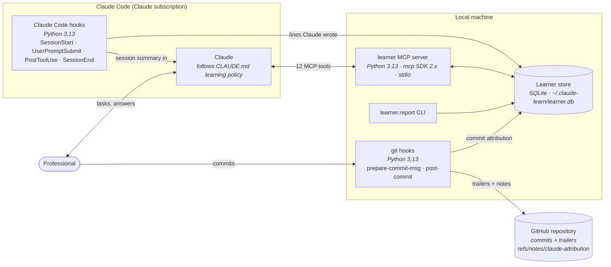
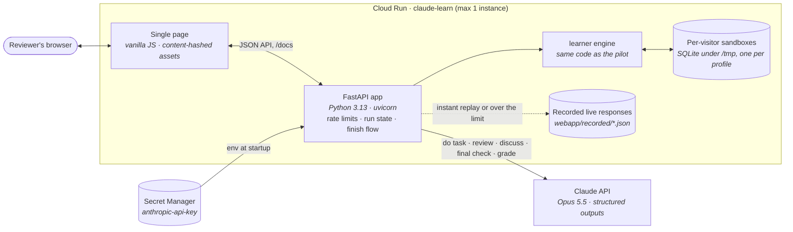

# Architecture

This repository has two parts that share one learner engine (`learner/`): the **Claude Code
pilot**, the real-world integration, and the **hosted web demo**, a no-setup version of the core
loop for reviewers. The design doc's Technical architecture tab covers the production design on GCP.

## Claude Code pilot

The pilot runs entirely on one machine, inside Claude Code on a Claude subscription. There are no
cloud services. Learner data stays in a local SQLite file outside the repository; the repository
only receives commit trailers and line-attribution notes.

### Tech stack

| Layer | Choice | Why |
| --- | --- | --- |
| Claude access | Claude Code on a Claude subscription | No API key or backend needed for a single-user pilot |
| Learning policy | `CLAUDE.md` | Claude Code loads it into every session in this repo |
| Learner model API | MCP server, Python 3.13, `mcp` SDK 2.x, stdio transport | Claude calls it as tools; no network service to run |
| Storage | SQLite (stdlib `sqlite3`) | Zero setup; one file per learner, outside the repo |
| Session context | Claude Code hooks (`SessionStart`, `UserPromptSubmit`, `PostToolUse`, `SessionEnd`) | Load learner context and record Claude-written lines without Claude having to remember |
| Provenance | git `prepare-commit-msg` and `post-commit` hooks, git notes | Trailers and line ranges travel with the repository |
| Repository host | GitHub (existing) | Easy to reproduce |
| Reporting | `python -m learner.report` | Exit-criteria metrics without a frontend |
| Tests | pytest | Unit tests plus end-to-end tests of the git hooks |

### Data flow for one task

1. **SessionStart hook** opens a session and gives Claude the learner summary: skill tracks, due
   reviews, commits to tag, withheld items to review, non-learning flags.
2. **Claude** records the task's concepts, reads the plan from `get_learner_context`, and does the
   work with the interventions the plan allows.
3. When Claude withholds part of the work, it stores the full draft with `record_baseline` and
   leaves `TODO(learner) <item_id>` markers.
4. **PostToolUse hook** records every line Claude writes.
5. On commit, **prepare-commit-msg** adds `Assisted-by` / `Claude-Session` trailers when the commit
   contains lines Claude wrote in this repository in the last 7 days. **post-commit** classifies each
   added line of the finished commit as `claude`, `claude_modified` or `human` (amends included),
   writes the attribution note, and records the commit. Merge commits are skipped.
6. In the next session, Claude tags the commit's concepts and reviews completed gaps against the
   baseline. Those become evidence, and the mastery rules update levels.

### What the pilot defers

The shared concept graph and Insights API (aggregates need 3 or more people), the key service
(disk encryption covers a local store), the Google Docs bridge, and the Bayesian mastery model.
See the design doc's Technical architecture tab for the production design on GCP.

## Hosted web demo

A single Cloud Run service at https://claude-learn-717902231295.us-central1.run.app. It reuses the
pilot's learner engine; each visitor gets a private sandbox store per learner profile, seeded with a
synthetic history ("You" starts empty). Visitors can also bring their own task: pasted, uploaded, or
loaded from a public GitHub file by the browser. Nothing persists beyond the container's lifetime.

### Tech stack

| Layer | Choice | Why |
| --- | --- | --- |
| Hosting | Cloud Run, one service, max 1 instance | No servers to run; one instance keeps in-memory run state and rate limits consistent |
| Backend | FastAPI + uvicorn, Python 3.13 | Same language as the learner engine; OpenAPI docs at `/docs` for API reviewers |
| Frontend | One HTML page, vanilla JS, no build step | Nothing to compile; a small safe Markdown renderer for Claude's prose |
| Claude | Anthropic SDK 1.13, `claude-opus-5-5`, JSON-schema structured outputs, effort per call, server-side fallback on a safety decline | Every response is typed (plan, draft, gaps, verdicts), so the UI never parses free text |
| Secrets | Secret Manager (`anthropic-api-key`) | The key never enters the repo or the image |
| Learner data | The pilot's SQLite store, one file per visitor and profile | Same rules and evidence as the pilot; nothing shared between visitors |
| Cost control | 30 live calls per visitor per hour, 800 per day; recorded responses as fallback | A public URL with bounded spend; the demo never breaks when limits are hit |
| Deploy | `scripts/deploy.sh <project>` (source deploy via Cloud Build) | One command; stores the key and sets `DEMO_TRUSTED_PROXY_HOPS=1` |

### Claude calls

| Call | When | Output |
| --- | --- | --- |
| `scope_task` | Start, own task only | 1-3 concepts (reusing the learner's existing names), title, language, file name, commit message, teach-back question; or "personal", which isn't tracked |
| `run_task` | Start | Plan-adapted draft with `[[GAP id]]` markers, orientation, prediction question, decisions, takeaway |
| `review` | Submit | Per-gap verdict (`as_expected`, `different`, `incorrect`, `not_attempted`) and a nudge that never gives the answer |
| `grade` | Prediction and explain-back answers | `correct`, `partial` or `incorrect`, with feedback |
| `discuss` | "Talk it through" message | A reply plus a classification: self-explanation, a SOLO-scored question, or critique |
| `final_check` | "I'm done" | Blocking and minor issues in the final version, and an explain-back question about it |

Run state is a JSON row per run. Slow Claude calls read it first; each change is then applied under a
per-run lock to a fresh read, so concurrent requests never overwrite each other. Revealed answers
have their own table. Every piece of evidence carries the run id, so a run's summary counts only
its own evidence. Sandboxes are deleted 7 days after creation; each request checks its own, and an hourly sweep
checks the rest.

The server derives the baseline (Claude's complete version) and the scaffold (with
`TODO(learner)` markers) from one draft, so what was withheld is always recorded.

### One run

1. **Start:** the learner engine returns the plan for the profile; Claude does the task to that
   plan. With "Live Claude" off, a recorded live response for the same plan is replayed. An own task
   is scoped first (`scope_task`), and needs live Claude.
2. **Work:** the learner answers the prediction, fills or reveals gaps, edits freely, and can talk
   it through with Claude (up to 8 messages). Each answer becomes evidence and may fire a rule.
3. **Submit** (any number of times): Claude reviews the gaps; "who wrote what" classifies every
   line as Claude, Claude edited, or the learner's.
4. **Finish:** a final check (never blocks) fixes the version: the draft locks until the learner
   chooses Keep editing. Then an optional explain-back question, graded against the learner's own
   version. Gaps filled since the last submit are reviewed before the run closes. Then a summary of
   ownership, level changes and when each concept comes back for review, and the file to copy or
   download next to the commit it would become in Claude Code. The run is then read-only.
