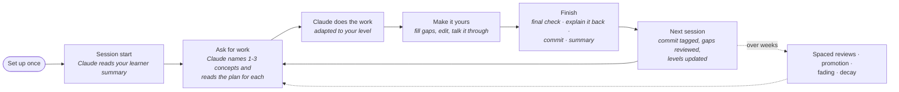

# User journey

A person asks Claude for work, gets working output every time, and owns more of it each time a
topic comes back. This page follows one person through a single task, the next session, and the
following weeks, first in Claude Code (real use) and then in the hosted demo. The design doc's
[User journey tab](https://claude.ai/code/artifact/5472a59b-895f-4bab-b99c-82b8cd220207) has the same
journey with charts.

## One task, start to finish (Claude Code)

| Stage | What you do | What Claude does | What gets recorded |
| --- | --- | --- | --- |
| Set up once | `scripts/install.sh`, then `claude` in the repository | Loads the learning policy (`CLAUDE.md`), the learner MCP server, and the hooks | A private learner store at `~/.claude-learn/learner.db`, outside the repository |
| Session start | Nothing | Handles the summary in one short message at most: tags your recent commits, compares completed gaps with its own version, weaves in one due review question if it fits, mentions at most one sign that learning isn't happening | Commit tags, gap reviews and review answers become evidence |
| Ask | Describe the task. Say "just do it" to skip learning for this request | Names the 1-3 transferable concepts and reads each one's plan: dial, track, level, allowed interventions | An occurrence per concept; two in 30 days moves a concept from one-off to skill track |
| Work | Read, answer at most one question | Always delivers working output, with at most three interventions sized to your level (table below). States its assumptions and rejected alternatives so you have something to push on | The interventions shown; a baseline of its complete version whenever it withholds a part |
| Make it yours | Fill `TODO(learner)` gaps or ask for the answer, edit freely, explain your reasoning, push back | Answers, nudges without giving away open gaps, concedes when you're right | Your answers and questions as evidence: explanations, question depth (SOLO), critique, real errors you catch. Asking for an answer is fine and recorded as "handed back"; reference lookups never count against you |
| Finish | Say you're done, or ask Claude to commit | A final check of your version (never blocks); one optional explain-it-back question about your version; the commit; then a short summary: your share of the lines, what changed in your learner model and why, and when each concept comes back | Your explain-back answer (or that you skipped it); `Assisted-by: Claude` and `Claude-Session` trailers; a note under `refs/notes/claude-attribution` classifying each added line as Claude's, Claude's edited by you, or yours |
| Next session | Nothing | Tags the commit's concepts; reviews your completed gaps against its baseline and tells you briefly how your version compares | Gap verdicts, and the commit's ownership: all-yours commits are the strongest evidence, unchanged Claude commits a warning sign |

What "sized to your level" means, per concept:

| Your level on the concept | What Claude leads with |
| --- | --- |
| Dial off, or "just do it" | Full output, no interventions |
| One-off topic (seen once) | Explains the key decisions, one takeaway, no questions |
| 0 · exposed | Short orientation, a fully worked solution with the reasoning, one takeaway |
| 1-2 · explain, predict | A prediction question, one or two meaningful gaps, a retrieval or "what if" question |
| 3-4 · modify, critique | Asks for your plan or offers alternatives; invites critique of its output |

## Over the following weeks

- **Spaced reviews.** A skill-track concept comes back for a short review after 2, 7, 21 or 45 days
  at levels 1, 2, 3 and 4. Claude weaves one into a task when it fits, never as a quiz on its own.
- **Fading.** As levels rise, worked examples give way to gaps, then to critique. Claude does
  less of the thinking for you.
- **Decay.** A concept with no evidence for 60 days drops one level, so support comes back.
- **Success signals** (`python -m learner.report`): you do tasks on a concept without Claude, you
  ask for the same explanation less often, your questions get deeper, and you catch Claude's
  mistakes.

## Your data

- Ask Claude "why am I at level 2 on retries?" or "what have you recorded about me?" and it shows
  the evidence and the rules that set each level.
- Turn learning down or off for a topic, or ask to learn how to do something rather than just
  about it.
- Personal topics (HR, health, personal legal) are never recorded as concepts.
- In the pilot, everything stays on your machine. In production, each store is encrypted per learner
  with organizational key escrow. The organization sees concept counts only for groups of three
  or more people, never sensitive topics (design doc, Data ownership).

## The same journey in the hosted demo

The demo compresses the journey into one page, with no install:

1. **Pick a learner.** Sam, Priya and Alex have synthetic histories at different levels; **You**
   starts empty.
2. **Pick a task.** One of two bundled tasks, or **Your own task**: describe it, then paste, upload,
   or load a public GitHub file. Claude names the concepts first, reusing yours.
3. **Work.** The same plan-driven draft, prediction question, `TODO(learner)` gaps, Submit for
   review, and "Talk it through with Claude".
4. **Finish** ("I'm done — use this version"), in four steps:
   1. A final check that never blocks. It locks the version.
   2. An optional explain-it-back question.
   3. A summary of what you wrote, what changed in your model, and when each concept comes back.
   4. The file to copy or download, next to the commit it would become in Claude Code.
5. **Come back.** Run another task as the same learner and the plan reflects what you just did.
   Download everything stored for the learner as JSON. Sandboxes are deleted 7 days after creation.

## Where the two differ

| | Claude Code pilot | Hosted demo |
| --- | --- | --- |
| Finishing | Final check, explain-back, commit, summary (in conversation) | Final check, explain-back, summary, download with a commit preview |
| Evidence from your repository | Commits tagged next session; work without Claude counts as unassisted use | None. Each run stands alone; no commits |
| Spaced reviews | Woven into later tasks when due | Shown as dates in the summary only |
| Data | Local SQLite file, yours to keep | Per-browser sandbox, deleted after 7 days; export as JSON |
| Claude | Claude Code on your subscription | Claude API (Opus 5.5), rate-limited; recorded replays when offline |

Both finish the same way, from the same policy: the four steps are in `CLAUDE.md` for Claude
Code and built into the demo's page, and both summaries come from the learner engine's
`session_summary`, so they count the same evidence.
